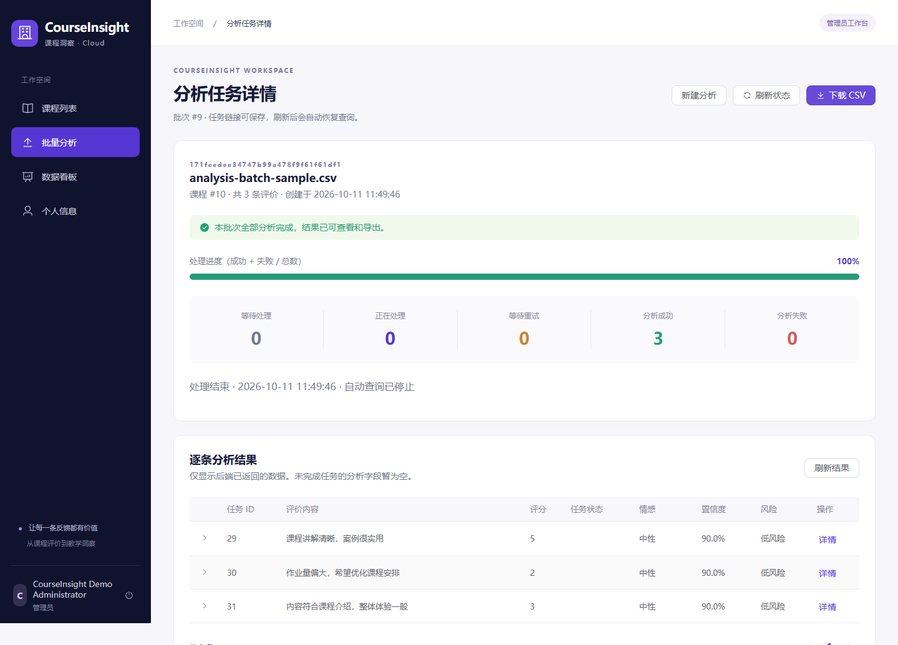
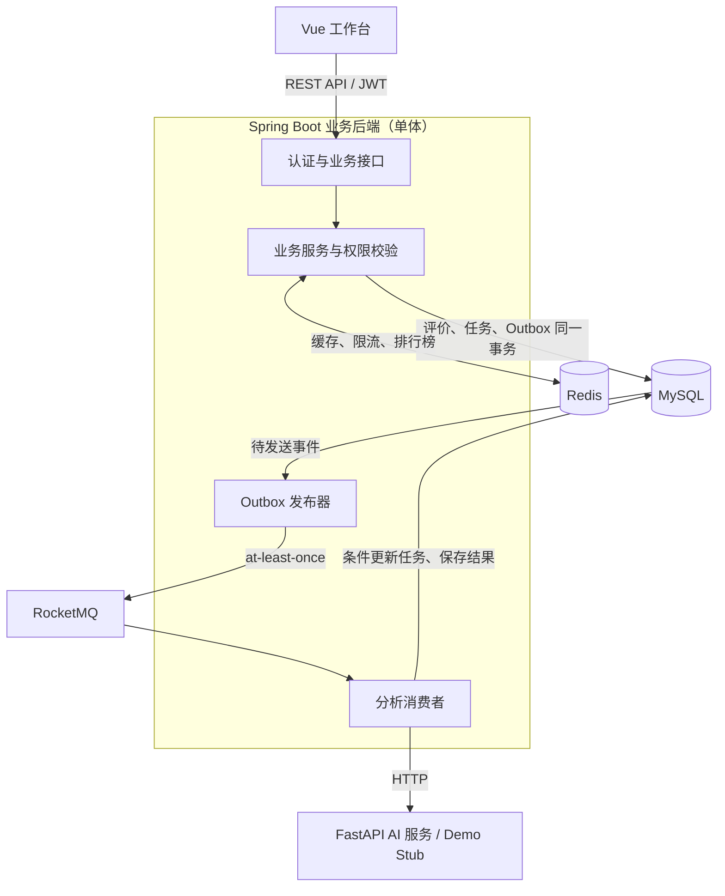

# CourseInsight Cloud

CourseInsight Cloud 是一个基于 Spring Boot、Vue 和 Python 的课程评价与教学分析项目。

学生提交评分与匿名评价，教师查看情感、关键词、课程维度和教学建议，管理员可以跨课程管理。评价通过 RocketMQ 异步分析，支持单条查询和 CSV 批量处理。

## 功能与展示

- 课程管理：搜索、分页，管理员创建、编辑课程并指定授课教师账号。
- 匿名评价：学生提交评分和反馈、管理本人评价，教师按需查看分析，管理员可维护评价。
- 批量分析：上传 UTF-8 CSV，查看进度、失败原因和逐条结果，下载 CSV；支持从历史任务返回，单次最多 200 条、2 MB。
- 教学建议：单条与批量详情统一展示摘要、行动建议和原文证据，支持大模型生成与本地兜底。
- 数据看板：课程评价数、平均评分、情感分布、任务状态和风险统计。
- 角色权限：教师只读查看本人课程的评价与分析，管理员负责课程维护和批量导入；学生不能读取完整分析结果。

批次页面使用 Stub 演示；单条分析页面来自本地 BERT 与大模型建议的实际联调。

批次进度与结果：



单条评价分析：


更多页面见[前端验证记录](docs/frontend-validation.md#截图)，权限与交互说明见[学生反馈与教师分析](docs/teacher-comment-analysis.md)。

## 技术栈

| 层次 | 主要技术与版本 |
| --- | --- |
| 后端 | Java 17、Spring Boot 3.5.16、Spring Security、JWT |
| 持久化 | MySQL 8.4、MyBatis-Plus 3.5.17、Flyway |
| 缓存与消息 | Redis 7.2、RocketMQ 5.3.2 |
| 前端 | Vue 3、TypeScript 5、Vite 7、Element Plus 2、ECharts 6 |
| AI 服务 | Python 3.12、FastAPI 0.139.2、BERT / TF-IDF / 规则降级 |
| 测试与观测 | JUnit 5、Testcontainers、Vitest、Playwright、k6、Prometheus / Grafana |

## 系统架构



MySQL 保存业务、任务和结果，Redis 保存缓存与可重建的派生数据。Outbox 发布器和消费者均在 Spring Boot 应用内，RocketMQ 负责传递分析任务；浏览器只访问 Java API，不直接调用 AI 服务。

情感分析优先使用本地 BERT，不可用时降级到 TF-IDF 或规则。教学建议默认开启；配置 LLM 后调用大模型，未配置或调用失败时使用本地模板。Stub 模式返回固定分析结果，便于检查业务流程。

## 核心技术实现

### RocketMQ 与 Transactional Outbox

评价落库和消息发送分属数据库与消息系统，直接双写会留下“数据已提交，消息未发出”的窗口。提交评价或上传批次时，系统在一个 MySQL 事务中写入评价、分析任务和 Outbox 事件，再由定时发布器发送到 RocketMQ。

Outbox 发布与任务恢复使用独立调度器。发布器通过固定线程池和有界提交窗口限制在途发送数量，状态更新必须匹配本次领取的 `publish_token`，防止旧发送覆盖新的发布尝试。

`SENT` 事件支持按保留期分批清理，默认关闭；待发送和失败事件保留重试。

消息按 at-least-once（至少一次）处理：Broker 接收后若 `SENT` 未落库，恢复时可能重发。消费端通过状态、事件代次和条件更新处理重复消息。当前本地 RocketMQ 为单节点异步刷盘配置，不保证 Broker 持久化故障下的消息不丢失。

### 异步任务状态与并发控制

上传成功表示任务已创建，不表示分析已完成。单条任务记录 `WAITING / PROCESSING / SUCCESS / FAILED`；批次根据成功和终止失败数量汇总为 `PROCESSING / COMPLETED / PARTIAL_FAILED / FAILED`，等待 MQ 重试的失败任务单独计数。

执行前通过条件更新领取任务，`current_event_id` 标识入队代次，`execution_token` 标识本次执行。结果写入必须匹配代次、token 和 `PROCESSING` 状态，成功状态与分析结果在同一事务中保存。

租约与过期判断使用 MySQL 时钟，恢复器为过期任务创建新代次和 Outbox 事件。前端轮询至终态，失败时退避，离开页面时取消请求。当前没有租约续期，超长 AI 调用仍可能重复执行。

### Redis 缓存

课程详情和统计采用 Cache Aside：优先读取 Redis，未命中时查询 MySQL 并回填。课程详情最大 TTL 为 30 分钟，空值和统计缓存最大 TTL 为 5 分钟，并加入 80%–100% 的随机抖动，减少缓存集中失效。

课程详情使用单实例锁槽和二次检查，减少并发重复回源。业务写入在事务提交后失效缓存；详情回填与失效共用锁槽，减少旧数据回填。

Redis 不可用时回退 MySQL。并发保护限于单实例，跨实例回填或删除失败仍可能留下短暂不一致，依赖后续失效或 TTL 到期收敛。缓存命中路径仍会查询用户状态以校验权限。

课程热度排行榜使用 ZSet，Lua 脚本完成数据写入后再设置就绪标记，避免读取半成品。

### Spring Security 与 JWT

API 使用无状态 JWT 认证，校验签名、有效期和 issuer 后，再读取数据库中的当前用户角色与启用状态，使禁用账号和角色变更能及时生效。

接口层限制角色，服务层继续校验课程归属、写操作权限及评价所有权。学生评价对外匿名展示，教师仅可读取归属课程的完整分析，不能修改课程、评价或分析任务；前端隐藏入口不能替代后端授权。

实现入口、重试和恢复细节见[技术设计与可靠性边界](docs/development.md#技术设计与可靠性边界)。

## 快速启动（Quick Start）

默认在宿主机运行 Java 和前端，在 Docker 中运行 MySQL、Redis、RocketMQ 和真实 Python AI 服务，使用隔离的 Demo 数据库和数据卷。启动、检查和停止均不需要额外的 AI 开关。

### 环境要求

- JDK 17，确保 `java` 可用；Maven 由仓库中的 Wrapper 提供。
- 已启动的 Docker Desktop / Docker Engine，包含 Docker Compose v2。
- Git；启动前端另需 Node.js 22.12+ 和 npm。
- 默认端口：后端 `8080`、前端 `5173`、MySQL `3307`、Redis `6380`、NameServer `9876`、Broker `10911 / 10909`、MQ 指标 `5557`、AI 服务 `8002`。Demo 与完整本地环境共用部分宿主机端口，不能按默认配置同时启动。

首次运行需要下载 Docker 镜像、PyTorch 和 Maven/npm 依赖。BERT 权重放置方式见 [AI 服务说明](courseinsight-ai-service/README.md#bert-权重)，未准备权重时使用 TF-IDF / 规则降级。

### Windows PowerShell

```powershell
git clone https://github.com/mofengyan595/courseinsight-cloud.git
Set-Location courseinsight-cloud

# 启动依赖并等待容器健康
.\scripts\demo.ps1 start

# 在当前终端启动后端并保持运行
Set-Location courseinsight-server
.\mvnw.cmd spring-boot:run '-Dspring-boot.run.profiles=demo'
```

出现 `Started CourseinsightServerApplication` 后，在仓库根目录打开第二个终端：

```powershell
.\scripts\demo.ps1 ready
.\scripts\demo.ps1 smoke
```

### macOS / Linux

```bash
git clone https://github.com/mofengyan595/courseinsight-cloud.git
cd courseinsight-cloud

bash scripts/demo.sh start
cd courseinsight-server
bash ./mvnw spring-boot:run -Dspring-boot.run.profiles=demo
```

后端启动后，在仓库根目录的第二个终端运行：

```bash
bash scripts/demo.sh ready
bash scripts/demo.sh smoke
```

这里显式使用 Bash 执行 Maven Wrapper，无需修改文件执行权限。

### 启动前端与演示账号

在仓库根目录另开终端，以下命令适用于上述两种环境：

```sh
cd courseinsight-web
npm ci
npm run dev
```

打开 <http://127.0.0.1:5173>：

| 用户名 | 密码 | 角色 |
| --- | --- | --- |
| `demo_admin` | `demo-admin-password` | `ADMIN` |

账号仅在 `demo` profile 中初始化。它和 [`demo.env`](demo.env) 中的 JWT 密钥都是公开、本地演示配置，不得用于其他环境。

网页演示路径：登录 → 创建课程 → 课程详情 → 批量分析评价 → 上传 CSV → 查看进度和结果 → 下载 CSV → 数据看板。

上传页可下载样例，也可使用 [`analysis-batch-sample.csv`](docs/examples/analysis-batch-sample.csv)。文件采用 UTF-8，表头为 `content,rating`，评分为 1–5 的整数。开发服务器将 `/api` 代理到 `http://localhost:8080`。

### 本地模型与大模型建议

`start` 默认启动真实 AI 服务，并自动加载根 `.env`（若存在），再用 `demo.env` 覆盖数据库等演示配置。单条评价和 CSV 分析默认生成教学建议；需要大模型时，在未提交的 `.env` 中配置 `LLM_API_KEY`、`LLM_BASE_URL`、`LLM_MODEL`，启动命令不变。

大模型会接收评价文本、关键词与维度证据，可能消耗 API 额度。未配置或调用失败时返回本地建议；实际来源可在前端分析详情中查看。历史结果不会自动重算，密钥不得放入前端或提交到仓库。

### 验证运行结果与停止服务

`ready` 检查依赖容器、Java 和真实 AI 服务。`smoke` 验证登录、课程创建、3 行 CSV 上传、成功计数和实际分析来源，并分别报告大模型建议与本地建议数量；失败时返回非零退出码，每次运行都会创建课程与批次并保留记录。

仅需固定结果测试时显式使用 `start -Stub`、`ready -Stub`、`smoke -Stub`（Bash：`--stub`）；该模式不加载根 `.env`。`/api/health` 仅检查存活，完整检查使用 `ready`。浏览器联调命令见[前端说明](courseinsight-web/README.md#测试与构建)。

结束时在前端和 Java 终端按 `Ctrl+C`，再从仓库根目录停止依赖，保留数据卷：

```powershell
# Windows
.\scripts\demo.ps1 stop
```

```bash
# macOS / Linux
bash scripts/demo.sh stop
```

独立的 `local` 开发环境、端口和监控配置见[本地开发文档](docs/development.md#启动本地应用)。

## 测试与性能

Java 测试分为无外部服务的单元、MVC/安全与 HTTP/MQ 合约测试，以及使用真实 MySQL、Redis Testcontainers 的集成测试。从仓库根目录运行：

```powershell
.\scripts\test.ps1 -Suite fast
.\scripts\test.ps1 -Suite integration  # 需要 Docker Engine
.\scripts\test.ps1 -Suite all          # 需要 Docker Engine
```

macOS/Linux 可在 `courseinsight-server` 中分别使用 `bash ./mvnw test '-Dgroups=!integration'`、`bash ./mvnw test '-Dgroups=integration'` 和 `bash ./mvnw test`。测试不读取根目录 `.env`，不启动项目 Compose；默认测试中的 MQ/AI 使用 mock，真实异步链路由 Demo smoke 单独验证。

已有验证记录：2026-10-14 后端 317 项 Java 测试通过；2026-10-16 前端 45 项单元测试、12 项异常交互测试及 BERT / 大模型建议联调通过。详情见[后端审计](docs/backend-audit.md#验证记录)和[前端验证记录](docs/frontend-validation.md)。

前端在 `courseinsight-web` 中运行 `npm run lint`、`npm run typecheck`、`npm test` 和 `npm run build`；Playwright 覆盖真实 Demo 与异常交互，两类验证分别记录。AI 服务测试见[开发文档](docs/development.md#ai-服务测试)，浏览器测试前提及执行方式见[前端 README](courseinsight-web/README.md#测试与构建)。

仓库保留了 k6 与指标采集报告，以下为历史本机实验中的代表性结果，均为每组 3 次：

| 实验 | 指标 | 调整前 | 调整后 |
| --- | --- | --- | --- |
| Redis 课程详情缓存 | p95 | 14.31 ms | 10.69 ms |
| Redis 课程详情缓存 | 每轮 MySQL `Com_select` | 6039 | 3039 |
| Outbox 发布并发 | 吞吐 | 36.595 tasks/s | 49.468 tasks/s |
| Outbox 发布并发 | 平均完成时间 | 27.559 s | 20.326 s |

- 缓存实验：100 RPS × 30 秒，相同 ID 顺序，miss/hit 交替。
- Outbox 实验：每轮 1000 任务、100 ms AI Stub，消费者 8，发布批次 100、间隔 1000 ms；对比串行与并发 4。

这些是历史单机实验结果，不代表生产性能或 BERT/LLM 推理吞吐，也不代表近期改动的性能增益。应用默认发布并发为 2；缓存命中路径仍有用户状态查询。

测试环境、复现命令与原始结果见 [Cache A/B 报告](performance/results/2026-08-09-phase-3-http-cache-P3_HTTP.md)、[Outbox 并发报告](performance/results/2026-08-10-phase-7-outbox-publisher-P7_OUTBOX.md)及[性能实验入口](performance/README.md)。Demo 与浏览器历史验证见[验收记录](docs/teacher-comment-analysis.md)。

## 项目结构与相关文档

```text
courseinsight-cloud/
├─ courseinsight-server/       Spring Boot 业务 API、权限、任务与 Outbox
├─ courseinsight-web/          Vue 工作台与前端测试
├─ courseinsight-ai-service/   FastAPI 与 NLP 分析
├─ scripts/                   Demo 启停、smoke 与 Java 分层测试
├─ docs/                      开发说明、功能设计、截图与 CSV 样例
├─ performance/               AI Stub、k6 脚本与实验报告
├─ deploy/observability/      Prometheus / Grafana 配置
├─ compose.demo.yaml          隔离 Demo 依赖
├─ compose.demo-ai.yaml       Demo 的真实 AI 服务配置
└─ compose.yaml               完整本地依赖与可选监控
```

- [本地开发与测试](docs/development.md)：环境配置、测试、服务启停、监控和排错。
- [技术设计与可靠性边界](docs/development.md#技术设计与可靠性边界)：Outbox、执行租约、条件更新、缓存一致性及源码入口。
- [后端工程审计](docs/backend-audit.md)：缓存并发、Outbox 调度、输入校验、安全边界及测试记录。
- [学生反馈与教师分析](docs/teacher-comment-analysis.md)：接口、权限、按需查询和验证边界。
- [前端说明](courseinsight-web/README.md)与[页面验收记录](docs/frontend-validation.md)：API 对接、异步交互、构建和截图。
- [AI 服务说明](courseinsight-ai-service/README.md)：分析接口、降级与模型权重。
- [性能实验](performance/README.md)与[报告索引](performance/results/README.md)：负载、方法、结果与限制。
