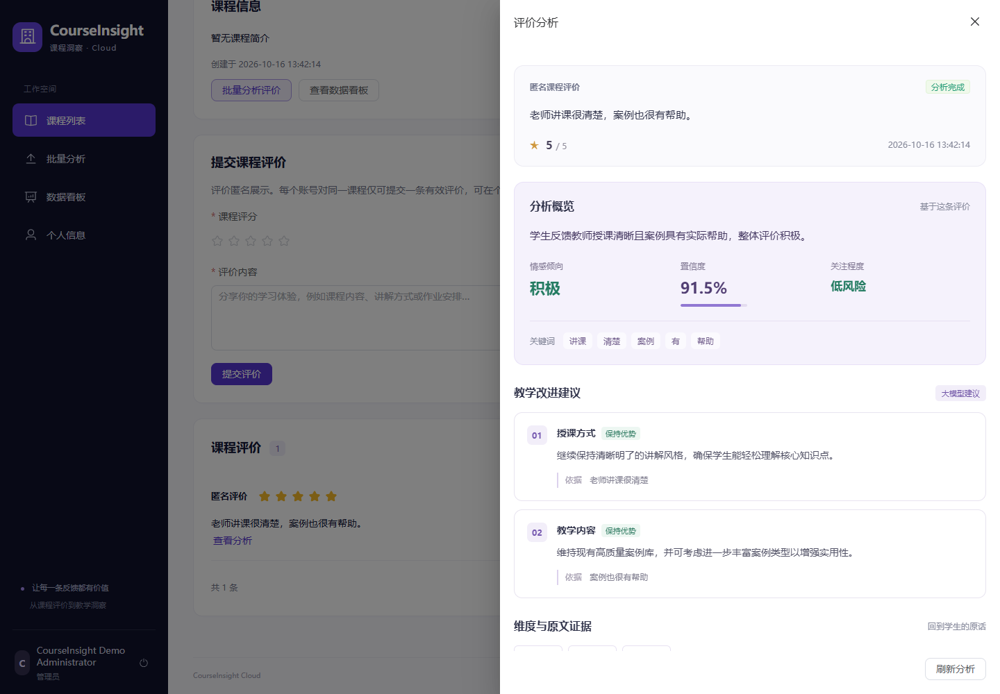
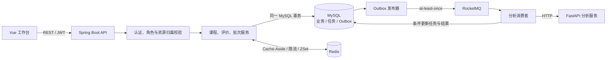

# CourseInsight Cloud

**基于 Spring Boot 的课程评价与教学分析系统：从评价提交、异步 NLP 分析到教学反馈，覆盖完整业务闭环。**

学生提交课程评分及匿名反馈，教师查看所授课程的分析结果，管理员管理课程、教师归属和 CSV 批量任务。后端使用 **MySQL + Redis + RocketMQ** 承载业务与异步处理，并通过 **Transactional Outbox、任务执行围栏和资源级授权** 处理消息投递、重复消费、超时恢复与权限边界。

> 项目定位：一个可本地运行、具有真实工程约束的 Java 后端项目；AI 分析由独立 Python 服务提供。仓库包含 Vue 工作台、Docker Demo、自动化测试及可追溯的性能实验。不是生产级分布式部署方案。

## 功能与演示

| 角色 | 主要能力 |
| --- | --- |
| 学生 | 浏览课程、提交评分与匿名评价、管理本人评价、查询本人分析任务状态 |
| 教师 | 查看所授课程的匿名评价、情感与关键词分析、教学建议；只读访问分析结果 |
| 管理员 | 创建和维护课程、指定授课教师、导入 CSV、查看批次进度与结果、导出 CSV |

- **异步分析**：评价写入后创建分析任务；支持情感、主题、关键词、风险等级和教学建议。优先使用本地 BERT，按条件降级为 TF-IDF / 规则；LLM 建议可选，失败时回退本地模板。
- **批量任务**：上传 UTF-8 CSV，按任务查询进度、错误与逐条结果，完成后导出 CSV；单文件最多 **2 MB、200 条**。
- **可观察与复测**：提供 Swagger / OpenAPI、Demo smoke、分层测试、k6 实验及可选 Prometheus / Grafana。



> 截图来自仓库内的真实 Demo 联调。完整交互与权限说明见 [学生反馈与教师分析](docs/teacher-comment-analysis.md)。

## 技术栈

| 模块 | 技术 |
| --- | --- |
| Java 后端 | Java 17、Spring Boot 3.5、Spring MVC、Spring Security、JWT、MyBatis-Plus |
| 数据与消息 | MySQL 8.4、Flyway、Redis 7.2、RocketMQ 5.3 |
| AI 分析服务 | Python 3.12、FastAPI、BERT、TF-IDF、规则降级、可选 LLM |
| Web 前端 | Vue 3、TypeScript、Vite、Element Plus、ECharts |
| 工程与测试 | Docker Compose、JUnit 5、Testcontainers、Vitest、Playwright、k6、Micrometer |

## 系统架构



Java 服务负责业务数据、授权、任务状态和消息生命周期；Python 服务只负责分析。浏览器不直接访问 AI 服务。Outbox 发布器和消费者运行在 Spring Boot 应用内，当前仓库不是多微服务部署。

## 关键工程设计

### 1. Transactional Outbox：解决数据库与 MQ 双写窗口

直接执行“写 MySQL → 发送 RocketMQ”时，数据库提交后若消息发送失败，就会出现已创建任务却没有消息的情况。

系统在**同一个 MySQL 事务**中写入评价 / 批次、分析任务与 Outbox 事件，再由后台发布器异步发送。发布器使用独立调度器、固定线程池和有界在途窗口；每次领取事件分配 `publish_token`，迟到的发送结果不能覆盖新一轮发布状态。

这一设计提供**至少一次处理**而非恰好一次：发送成功但 `SENT` 未落库仍可能再次投递，必须由消费端处理重复消息。详情见 [技术设计](docs/development.md#技术设计与可靠性边界)。

### 2. 任务围栏：避免超时恢复后的旧 Worker 覆盖新结果

分析任务使用 `WAITING / PROCESSING / SUCCESS / FAILED` 等状态。消费者执行前通过条件更新领取任务，记录：

- `current_event_id`：当前入队代次，用于区分恢复前后的消息。
- `execution_token`：本次 Worker 执行身份，用于隔离重复消费和超时接管。
- 数据库时间和执行租约：判断任务是否过期，并重新创建 Outbox 事件。

写入结果时同时校验任务状态、事件代次与执行令牌；成功状态及结果在同一事务中保存。**旧执行即便最后返回，也不能覆盖已被新执行者接管的任务结果。**

当前没有租约续期，超长 AI 请求仍可能产生重复执行；本项目通过结果围栏约束最终持久化，而不声称完全避免重复计算。

### 3. Redis 缓存：优化热点读取，同时保留一致性边界

课程详情和统计采用 Cache-Aside；详情未命中时访问 MySQL 并回填，空值缓存处理同一不存在 ID 的重复访问。TTL 使用随机抖动，降低集中失效风险；Redis 不可用时回源数据库。

课程详情的**单实例锁槽 + 二次检查**减少并发回源；课程修改后在事务提交后失效缓存，详情回填与本实例失效共用锁槽，收敛旧值回填竞态。课程热度排行榜通过 Redis ZSet 和 Lua 原子发布就绪标志。

单实例锁槽不保证跨实例强一致，缓存失效失败仍可能短暂读到旧值；因此不把该方案描述为全局一致缓存。

### 4. JWT + RBAC + 资源归属：防止跨用户越权

Spring Security 验证 JWT 签名、有效期和 issuer 后，按请求查询当前用户状态和角色，避免仅依赖令牌中的旧权限。接口层限制角色，服务层进一步校验课程归属、评价所有权和分析结果可见性。

例如：教师只能查看**自己负责课程**的完整分析；学生可以查询本人任务状态，但不能读取教师级分析结果；管理员才可以执行课程维护和 CSV 导入。前端隐藏按钮不作为授权依据。

**源码阅读入口：**[Outbox 发布器](courseinsight-server/src/main/java/com/courseinsight/server/message/AnalysisOutboxPublisher.java) · [租约恢复调度器](courseinsight-server/src/main/java/com/courseinsight/server/message/AnalysisTaskLeaseRecoveryScheduler.java) · [课程缓存业务逻辑](courseinsight-server/src/main/java/com/courseinsight/server/service/CourseService.java)。

## 测试与性能证据

仓库提供 Java 单元 / MVC / Security / HTTP 合约测试，以及使用真实 MySQL、Redis Testcontainers 的集成测试。RocketMQ + AI 端到端流程通过 Demo smoke / 浏览器联调另行验证。

**仓库记录的历史验证：**2026-11-02 完整 Java 测试 **365 项通过，0 失败、0 跳过**。这一数字对应当时的代码与环境，不代表本 README 修改后重新执行。

| 单机实验 | 指标 | 调整前 | 调整后 |
| --- | --- | ---: | ---: |
| 课程详情 Redis 缓存 | HTTP p95 | 14.31 ms | 10.69 ms |
| 课程详情 Redis 缓存 | 每轮 MySQL `Com_select` | 6,039 | 3,039 |
| Outbox 发布并发 | 吞吐 | 36.595 tasks/s | 49.468 tasks/s |
| Outbox 发布并发 | 平均完成时间 | 27.559 s | 20.326 s |

- 缓存实验：**100 RPS × 30 s**，相同请求 ID 顺序，miss/hit 交替。
- Outbox 实验：每轮 **1,000 个任务**，固定 **100 ms AI Stub**，消费者 8 个，对比串行发布与并发数 4；系统默认发布并发数为 2。
- **边界**：数据来自历史本机实验，不是生产吞吐、真实 BERT / LLM 推理性能，也不能直接归因于后续代码变更。

原始条件与结果：[Cache A/B 报告](performance/results/2026-08-09-phase-3-http-cache-P3_HTTP.md) · [Outbox 并发报告](performance/results/2026-08-10-phase-7-outbox-publisher-P7_OUTBOX.md) · [性能实验索引](performance/README.md)。

## 快速开始

准备 **JDK 17、Git、Docker Engine / Docker Compose v2**；运行前端另需 **Node.js 22.12+ 和 npm**。首次安装需要下载镜像和依赖。默认演示环境由 Docker 启动 MySQL、Redis、RocketMQ 和真实 Python AI 服务，Java 与前端在宿主机运行。

### Windows PowerShell

终端 1：

```powershell
git clone https://github.com/mofengyan595/courseinsight-cloud.git
Set-Location courseinsight-cloud
.\scripts\demo.ps1 start
Set-Location courseinsight-server
.\mvnw.cmd spring-boot:run '-Dspring-boot.run.profiles=demo'
```

后端出现 `Started CourseinsightServerApplication` 后，在**仓库根目录**打开终端 2：

```powershell
.\scripts\demo.ps1 ready
.\scripts\demo.ps1 smoke
```

### macOS / Linux

终端 1：

```bash
git clone https://github.com/mofengyan595/courseinsight-cloud.git
cd courseinsight-cloud
bash scripts/demo.sh start
cd courseinsight-server
bash ./mvnw spring-boot:run -Dspring-boot.run.profiles=demo
```

后端启动后，在**仓库根目录**的终端 2：

```bash
bash scripts/demo.sh ready
bash scripts/demo.sh smoke
```

`ready` 检查依赖、Java 和 AI 服务；`smoke` 验证登录、课程创建、3 行 CSV 上传、结果计数及分析来源。两者会检查不同条件，`/api/health` 仅代表存活。`smoke` 会保留本次创建的演示数据。

### 启动 Web 工作台

另开终端，从仓库根目录执行：

```bash
cd courseinsight-web
npm ci
npm run dev
```

- Web：<http://127.0.0.1:5173>
- Swagger UI：<http://localhost:8080/swagger-ui.html>
- OpenAPI：<http://localhost:8080/v3/api-docs>
- **仅限 Demo 环境**的管理员账号：`demo_admin` / `demo-admin-password`。

可体验：**登录 → 创建课程 → 上传 CSV → 观察批次进度 → 查看分析 → 下载结果**。CSV 样例见 [analysis-batch-sample.csv](docs/examples/analysis-batch-sample.csv)，列名为 `content,rating`，评分为 1–5 的整数。

未准备本地 BERT 权重时会使用 TF-IDF / 规则降级；LLM 未配置或调用失败时使用本地教学建议。可在未提交的 `.env` 中配置 `LLM_API_KEY`、`LLM_BASE_URL`、`LLM_MODEL`。演示公开账号和密钥**不得用于其他环境**。

只需固定分析结果进行业务联调时，可使用 `start -Stub` / `ready -Stub` / `smoke -Stub`（Bash 为 `--stub`），该模式不是实际 NLP 模型测试。AI 权重与选项见 [AI 服务说明](courseinsight-ai-service/README.md)。

### 停止与测试

先在 Java / 前端终端按 `Ctrl+C`，再从仓库根目录停止 Demo 依赖（保留数据卷）：

```powershell
# Windows
.\scripts\demo.ps1 stop

# Java 快速测试 / Testcontainers 集成测试 / 全部测试
.\scripts\test.ps1 -Suite fast
.\scripts\test.ps1 -Suite integration
.\scripts\test.ps1 -Suite all
```

Linux / macOS 可使用 `bash scripts/demo.sh stop`；Java 测试可在 `courseinsight-server` 目录用 `bash ./mvnw test`（完整测试需要 Docker Engine）。前端在 `courseinsight-web` 中运行 `npm run lint`、`npm run typecheck`、`npm test`、`npm run build`。

## 项目结构与文档

```text
courseinsight-cloud/
├── courseinsight-server/       Spring Boot API、鉴权、缓存、任务与 Outbox
├── courseinsight-web/          Vue 工作台
├── courseinsight-ai-service/   FastAPI / NLP / LLM 适配
├── scripts/                   Demo、健康检查与测试脚本
├── docs/                      设计、审计、截图与 CSV 样例
├── performance/               k6、Stub 与历史实验报告
├── deploy/observability/      Prometheus / Grafana
├── compose.demo.yaml
└── compose.yaml
```

- [开发与运行细节](docs/development.md)：完整本地环境、监控、任务恢复和排障。
- [后端工程审计](docs/backend-audit.md)：源码位置、并发问题、修复及剩余风险。
- [权限与前端交互](docs/teacher-comment-analysis.md)：学生、教师和管理员的行为边界。
- [前端说明](courseinsight-web/README.md) · [AI 服务说明](courseinsight-ai-service/README.md) · [性能实验](performance/README.md)。

**已知边界**：当前 MQ 为单节点本地配置，异步刷盘下不承诺 Broker 故障零丢失；采用 at-least-once 而非 exactly-once；任务租约无续期；缓存并发控制主要针对单实例。上述行为与本地 Demo 的实测范围不等同于生产 SLA。
