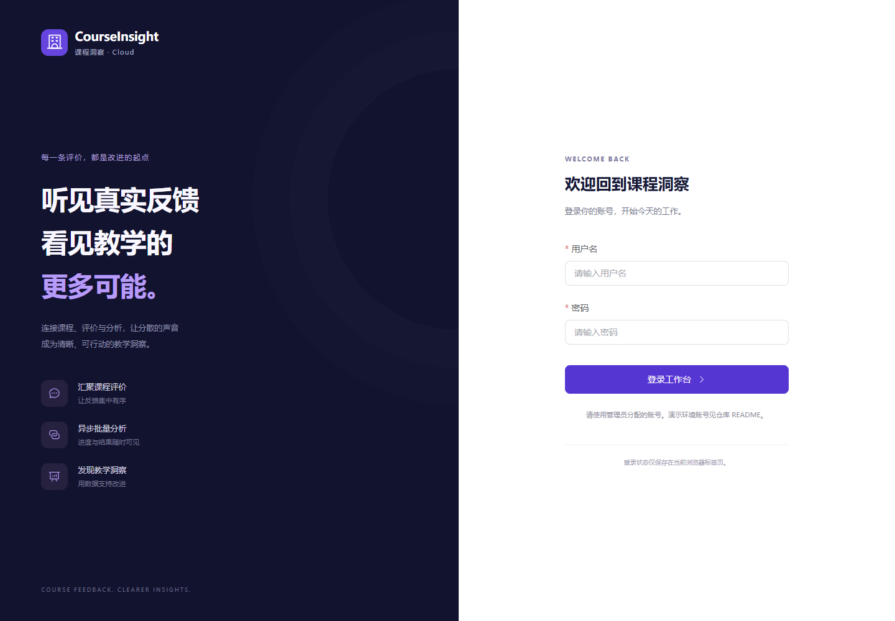
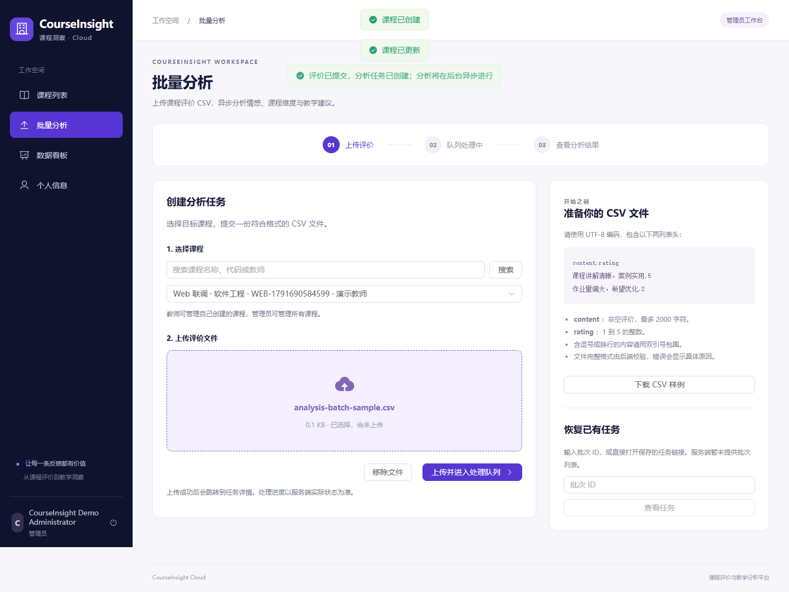
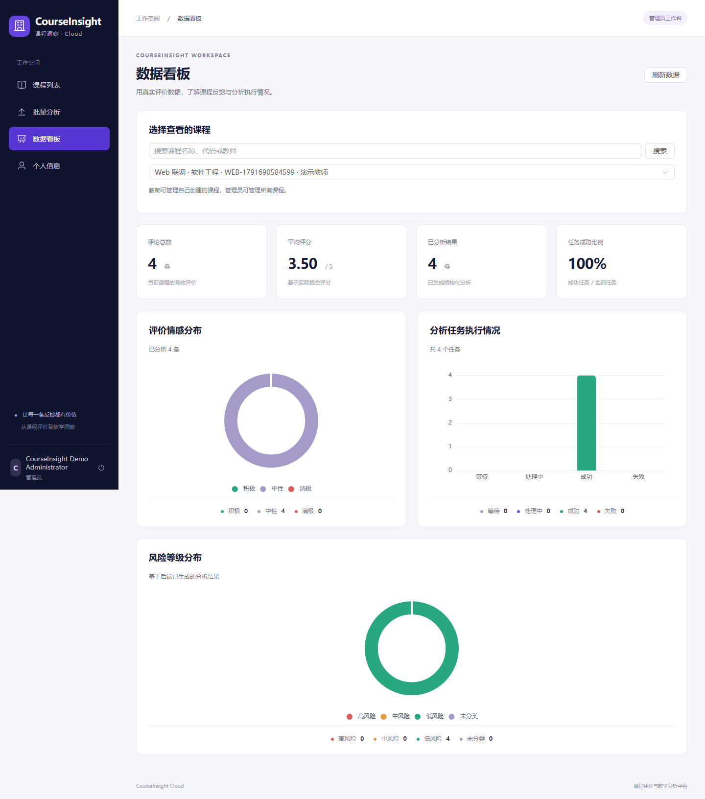
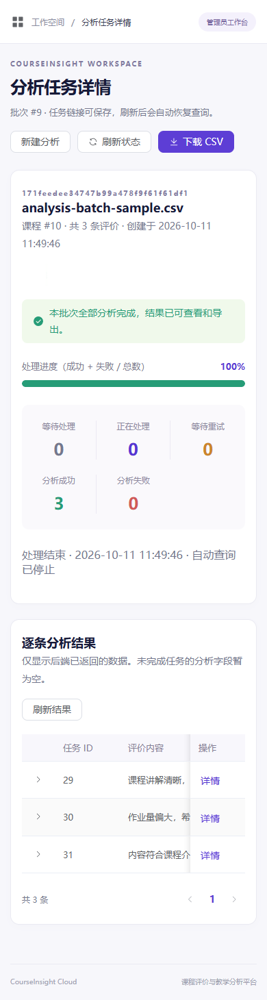

# Vue 前端验收记录

日期：2026-10-11。环境：Windows、Node.js 22.17.1、JDK 17、Docker Desktop、Chrome。

## 已执行检查

| 检查 | 实际结果 |
| --- | --- |
| `npm run lint` | 通过，0 warning |
| `npm run typecheck` | 通过 |
| `npm run build` | 通过；Vite 提示 Element Plus 与 ECharts 相关 chunk 超过 500KB，属于体积优化项 |
| `npm test` | 4 个测试文件、24 项通过 |
| Playwright 真实 Demo | 通过，使用真实 Spring Boot REST API 与隔离 Demo 依赖 |
| Playwright 异常交互 | 8 项通过，契约响应仅在测试中注入 |
| `scripts/test.ps1 -Suite fast` | 193 项通过，0 失败 / 错误 / 跳过 |
| `scripts/test.ps1 -Suite integration` | 73 项通过，真实 MySQL/Redis Testcontainers，0 失败 / 错误 / 跳过 |
| `scripts/demo.ps1 smoke` | 通过；真实异步批次 COMPLETED，3 条结果 |

前端源码未接入 Mock 数据。异常交互测试与真实联调分别验收，不将注入响应视为真实后端调用证据。

## 真实浏览器链路

`tests/e2e/demo.spec.ts` 使用现有公开、本地、隔离 Demo 管理员账号，账号通过进程环境提供，没有写入前端源码或构建。

1. 从网页登录，自动跳转课程列表。
2. 创建课程并进入详情，再编辑课程简介并读回。
3. 通过键盘评分组件选择 4 星，提交唯一内容的评价并读回。
4. 从课程详情进入上传页，上传前端提供的 3 行样例 CSV。
5. 跳转带 batchId 的 URL，经过 Java、Transactional Outbox、真实 RocketMQ、AI Stub 后进入 COMPLETED。
6. 网页显示 3 条成功结果、情感、置信度、风险和分析详情。
7. 刷新任务页面，依据 URL 恢复查询。
8. 下载 CSV 并检查实际文件包含评价内容和 neutral 分析结果。
9. 查询课程看板，显示真实的评论总数、平均评分、情感、任务和风险图表。
10. 切换 390×844 手机视口，检查页面无整体横向溢出、导航可打开，结果表可在局部横向滚动。
11. 进入个人信息，确认并删除本轮测试刚提交的评价。

测试创建的课程与 CSV 批次保留在隔离 Demo 数据库中，不删除数据卷。单条测试评价通过真实个人删除接口移除。

## 异常与边界

- 登录错误、未登录守卫、手机登录布局。
- 401 清理会话并跳转登录；STUDENT 隐藏管理入口，直接访问管理路由受阻。
- 403 明确权限不足，停止无意义轮询。
- 课程无数据、网络失败、手动恢复。
- 错误文件扩展名、后端 CSV 表头校验错误。
- PARTIAL_FAILED 显示独立提示、失败原因；终态不继续轮询，确认重试后显示重新入队并恢复状态查询。
- 零数据看板显示空状态，不渲染虚构图表，平均评分显示缺省。
- 单元测试另覆盖 FAILED/COMPLETED 终态、慢请求不重叠、退避与三次失败暂停、卸载取消、业务错误和 Blob JSON 错误。

## 截图

以下均来自真实 Demo，未填充随机或伪造业务数据。

登录：

CSV 上传：

批次完成与实际结果：

真实统计看板：

手机视口：

## 尚未验证 / 延后范围

- Demo 使用原有 deterministic AI Stub，固定返回 neutral、0.9 置信度、low 风险与 stub 来源；这验证完整调用链，不验证真实 BERT 模型推理、准确率或建议质量。
- 部分失败和死信恢复的前端交互使用可重复的测试响应验证；没有主动破坏 Demo 的 AI/MQ 服务制造真实失败。后端相关语义由现有 Java 单元与集成测试覆盖。
- 用户管理属于可选第二阶段，本次没有接入 AdminUserController。
- Nginx 同源代理示例已提供，未部署生产服务器或验证生产 HTTPS/CSP。
- Element Plus 全量注册与按页面懒加载的 ECharts 仍存在大 chunk 提示，可进一步按需导入；没有提高阈值掩盖提示。
- 本次未重新运行性能 benchmark，性能脚本、后端配置和任务逻辑均未修改，不声称吞吐量有变化。

仓库原有用户文件 `docs/resume-notes.md` 不属于本任务，保持未跟踪且不进入前端提交。
