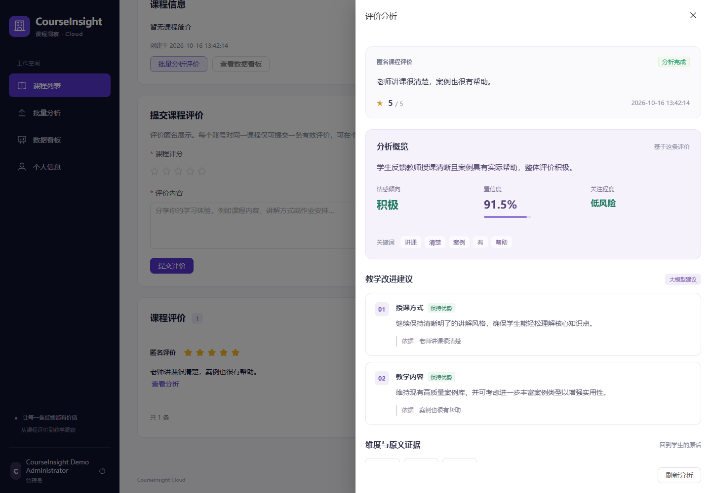

# 学生反馈与教师分析

学生在课程详情提交评分和文字评价，页面提示“评价提交成功，感谢你的反馈。”。后端沿用已有事务创建评论、AnalysisTask 和 Outbox；RocketMQ 消费任务并调用 AI Stub，结果保存到 MySQL。学生继续浏览匿名评价，在个人中心查看、删除自己的评价。

教师在本人管理课程的“课程评价”区域点击“查看分析”，管理员可查看所有课程。列表不预加载逐条分析；抽屉按需查询原评价、评分、任务状态、情感及置信度、关键词、维度、证据、建议、风险和来源。课程页的整体数据看板、CSV 批量分析入口保持不变，管理员原有 Demo 工作流兼容。

## 只读 API

`GET /api/comments/{commentId}/analysis`，使用原 JWT Bearer 鉴权和 `{code,message,data}` 响应。成功码为 0，data 结构：

| 字段 | 契约 |
| --- | --- |
| comment | 复用 CommentDetailResponse：id、courseId、content、rating、anonymous、status、createdAt、updatedAt |
| task | 复用 AnalysisTaskDetailResponse：id、taskNo、commentId、courseId、status、retryCount、failureReason、startedAt、completedAt、deadLetteredAt、createdAt、updatedAt |
| result | SUCCESS 时为 AnalysisResultResponse，其余状态为 null |

result 字段：id、language、sentiment、confidence、sentimentSource、sentimentDevice、topics、topicEvidence、keywords、longTextHandled、longTextTruncated、advice、riskLevel、adviceSource、createdAt。topics、topicEvidence、keywords、advice 保留实际 JSON 结构，不编造固定数组格式。

无登录返回 401；STUDENT 一律 403，即使评价属于本人；TEACHER 必须通过服务层 CourseManagementAccessService 的实际课程归属检查，否则 403；ADMIN 可跨课程查询。无效数字 ID、已删除评论、缺失任务或成功任务缺失结果返回 404。非数字 ID 按现有参数错误处理返回 400。

评论响应不包含 userId、username、displayName，任务响应不包含执行令牌或内部事件身份。原 `/analysis-task` 只返回任务状态，允许学生查看本人任务的权限保持不变，不能用于授权完整分析。

本次只新增 Controller、查询 Service、响应 DTO 和精确匹配的安全规则。数据库结构、评论提交事务、RocketMQ、Outbox、AI Stub、任务执行及结果持久化均保持原实现。

## 抽屉状态与取消

- WAITING / PROCESSING：显示“分析中”，请求完成约 2 秒后继续，避免重叠请求。
- SUCCESS：显示真实结果并停止；FAILED：显示失败原因并停止。单条查询没有百分比或任务重试 API，提供手动刷新，不新增虚构操作。
- 网络错误：4 秒、8 秒退避，连续 3 次失败暂停；401、403、404 立即暂停。统一请求层继续执行 401 会话清理和登录跳转。
- 关闭、切换评论、离开课程页：清理定时器并取消在途请求；轮询 generation 检查阻止迟到成功/失败响应覆盖新数据。

## 本地运行与验证

依赖、Java demo profile、Vue 启动方式见 [前端 README](../courseinsight-web/README.md)。不需要真实 BERT 或外部收费服务。

```powershell
# 仓库根目录，Docker Engine 已就绪
.\scripts\test.ps1 -Suite fast
.\scripts\test.ps1 -Suite integration
.\scripts\demo.ps1 smoke

Set-Location courseinsight-web
npm run lint
npm run typecheck
npm test
npm run build

# 启动 Java demo 后，在当前终端设置隔离 Demo 管理员凭据
$env:E2E_USERNAME = '<隔离 Demo 管理员用户名>'
$env:E2E_PASSWORD = '<隔离 Demo 管理员密码>'
try { npm run test:e2e } finally {
  Remove-Item Env:E2E_USERNAME, Env:E2E_PASSWORD
}
```

新增真实浏览器测试通过注册 API 创建随机学生、教师和另一教师，管理员通过已有角色 API 授权测试教师；教师创建课程，学生在网页提交，教师在网页看到实际 MQ + Stub 持久化结果。检查未登录、学生直接调用、跨教师访问被拒绝，管理员可读取，删除后 404，以及终态不继续轮询。注册限流每来源 10 分钟 5 次，每次测试注册 3 人，重复运行需等待窗口恢复，不能禁用限流。

真实测试只用于隔离 Demo。随机密码只在测试进程中使用，不写入源码、日志或会话产物；测试保留测试课程和账号，成功后通过学生自己的删除 API 软删除测试评价，不直接修改 Demo 数据库。

数据库集成测试使用真实 MySQL 验证评论/任务/Outbox 的创建与结果持久化，AI client 使用确定性 fake；真实 RocketMQ 和 HTTP Stub 由浏览器测试与 Demo smoke 单独验证。Stub 返回 `performance_stub` 来源，验证完整业务链路，不代表真实 BERT 推理准确率。

GitHub Actions：原 Frontend CI 继续运行 npm ci、lint、typecheck、Vitest、build；新增 Backend CI 在 Ubuntu / Java 17 运行非 integration 测试。需要 Docker/浏览器的 MySQL/Redis 集成和真实 Demo 保留本地验证。

## 本次实际验证（2026-10-11）

| 验证 | 结果 |
| --- | --- |
| Java fast | 212 项通过，无失败、错误或跳过 |
| Java integration | 74 项通过，无失败、错误或跳过；真实 MySQL / Redis Testcontainers |
| 新增 Service / MVC 安全测试复跑 | 19 项通过 |
| 前端 lint / typecheck | 通过 |
| Vitest | 43 项通过，含新增抽屉 9 项 |
| 生产构建 | 通过；保留已有 ECharts / Element Plus 大于 500 kB 的包体积提示 |
| 浏览器异常交互契约 | 12 项通过，含学生无分析入口、按需查询、抽屉关闭和 SPA 返回取消 |
| 浏览器完整回归 | 14 项全部通过、无跳过；包含新的学生 → MQ → 教师分析与原管理员 CSV 上传/下载/看板真实链路 |
| 原 Demo smoke | 真实 MQ + Stub 批次完成，3 条成功结果 |

新增服务测试覆盖课程所有权、学生拒绝访问、管理员跨课程、匿名响应、缺失/删除评论，以及 WAITING、PROCESSING、SUCCESS、FAILED。新增抽屉测试覆盖状态转换、终态停止、401/403/404、手动恢复、评论切换、关闭/卸载取消和迟到成功/失败的数据隔离。原批次、看板、会话、上传/下载测试继续执行。

首次真实测试已到达 SUCCESS，但来源断言误写为 `stub` 导致失败；核对现有 Stub 实现后改为 `performance_stub`，随后完整 14 项复跑通过。没有修改 Stub 或降低断言标准。

单条分析界面（2026-10-16 更新，来自隔离 Demo 的 BERT 与大模型建议联调）：


